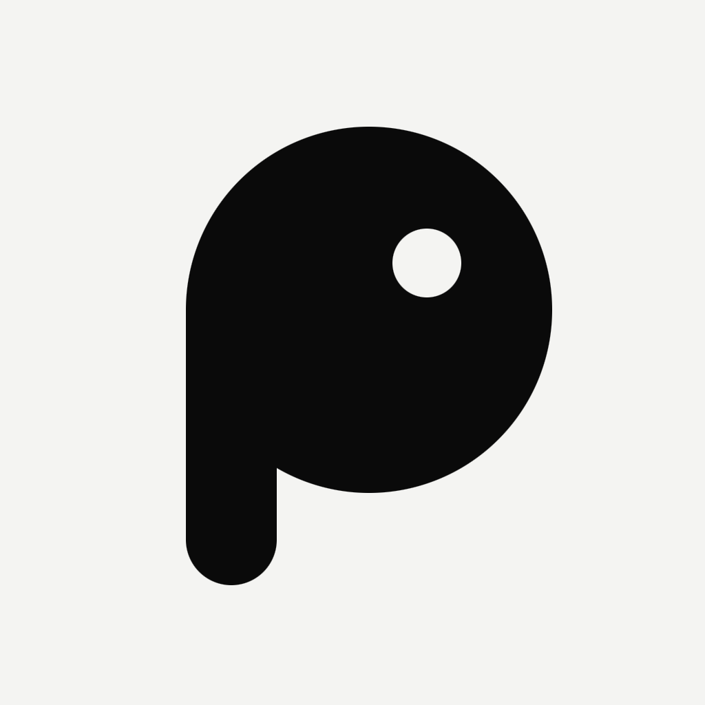

  <picture>
    <source media="(prefers-color-scheme: dark)" srcset="design/brand/icon-1024.png">
    
  </picture>

<h1 align="center">The piu. Manifesto</h1>

<strong>Freedom, security and independence on the internet.</strong>

<a href="MANIFESTO.md">Português</a> (original)

---

I created piu. because I believe communication between people must be decentralized.

Today almost every conversation passes through a few servers, owned by a few companies, under a few jurisdictions. Whoever controls those points controls who speaks, what is said and who gets to know. We are entering a surveillance state that has already destroyed much of our privacy: messages, contacts, location and habits have become a permanent record, collected by default and kept indefinitely.

piu. is my answer to that. A messenger where messages travel from device to device, end-to-end encrypted, with no central server, working even without internet. Communication infrastructure should not depend on permission. It can and should be built by people themselves.

— **Lucas Cardeal**, creator of piu.

## Principles

1. **Communication is a right, not a granted service.** No intermediary should be able to read, filter or switch off a conversation between two people.
2. **Privacy by default.** What is yours stays on your device, encrypted. Collecting the minimum is not a setting: it is the rule.
3. **No central point of control.** The network is made of devices and nodes run by the community. If one part goes down, the rest keeps going.
4. **Independence from the internet.** Bluetooth, Wi-Fi Direct, local networks, radio: a message finds its way even when the connection is cut.
5. **Verifiable security.** The code is open so anyone can check what it does, audit it and fix it. Trust comes from verification, not from promises.
6. **The infrastructure belongs to those who build it.** Whoever shares bandwidth, power and storage with the mesh is part of it and is recognized for it.

## Privacy is not a crime

Privacy does not exist for committing crimes. It protects journalists and their sources, people facing violence, those living under authoritarian governments, anyone who simply wants to talk without being watched. It is a condition of freedom, not a hiding place.

Tools should not be punished because of bad users. A lock is not guilty of the crime of whoever locks the door, and encryption is not guilty of what a few do with it. Weakening everyone's privacy to watch a few leaves everyone more vulnerable, including those it claimed to protect.

## How the community can take part

piu. is free software ([AGPL-3.0](LICENSE)). The project moves forward with whoever joins:

- **Contribute code, tests, documentation, translation and design.** See the [contributing guide](CONTRIBUTING.md).
- **Fork it.** Adapt piu. to your reality, your community, your country.
- **Create and improve protocols.** The network protocol ([LNNP](docs/lnnp/especificacao-v1.md)) is open. Propose extensions, new transports and security improvements.
- **Keep the mesh alive.** Run a node, bring the network where it does not reach yet.
- **Audit.** Found a flaw? Report it, so everyone is safer.

## Proposals

Any proposal can be discussed and implemented **as long as it does not violate the principles of freedom and privacy.** These do not belong in the project:

- backdoors, master keys or any special access to the content of conversations;
- collection of personal data beyond the minimum needed to work;
- central points that allow reading, censoring or switching off the network;
- mechanisms that identify people without their consent.

When in doubt, ask: *does this make people freer and better protected, or less?*

---

<em>piu. Communication belongs to those who talk.</em>

