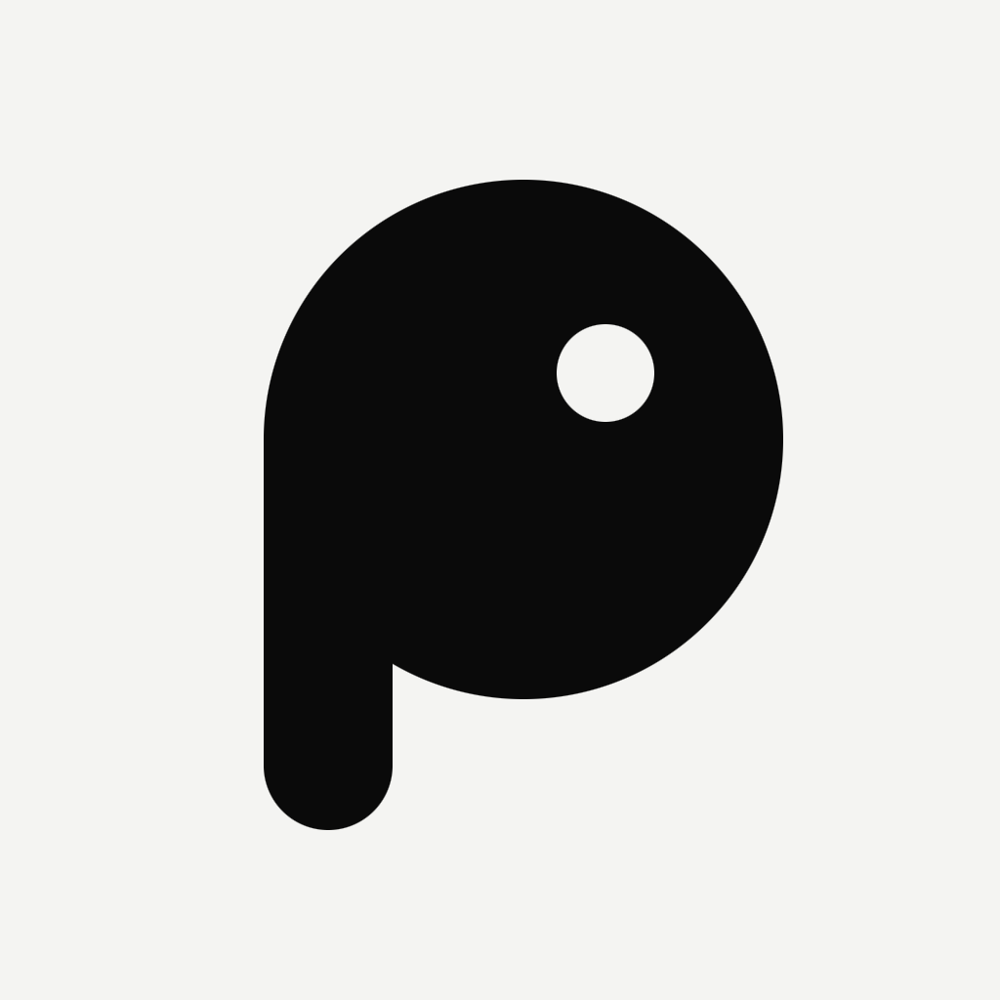

  
  &nbsp;&nbsp;
  

<h1 align="center">Manifesto do piu.</h1>

<strong>Liberdade, segurança e independência na internet.</strong>

<a href="MANIFESTO.en.md">English</a>

---

Eu idealizei o piu. porque acredito que a comunicação entre as pessoas precisa ser descentralizada.

Hoje, quase toda conversa passa por poucos servidores, de poucas empresas, sob poucas jurisdições. Quem controla esses pontos controla quem fala, o que se fala e quem fica sabendo. Estamos entrando num estado de vigilância que já destruiu boa parte da privacidade: mensagens, contatos, localização e hábitos viraram registro permanente, coletado por padrão e guardado por tempo indeterminado.

O piu. é a minha resposta a isso. Um mensageiro em que as mensagens viajam de aparelho em aparelho, com criptografia de ponta a ponta, sem servidor central e funcionando mesmo sem internet. A infraestrutura de comunicação não deve depender de permissão. Ela pode e deve ser construída pelas próprias pessoas.

— **Lucas Cardeal**, idealizador do piu.

## Princípios

1. **Comunicação é um direito, não um serviço concedido.** Nenhum intermediário deve poder ler, filtrar ou desligar a conversa entre duas pessoas.
2. **Privacidade por padrão.** O que é seu fica no seu aparelho, cifrado. Coletar o mínimo não é uma opção de configuração: é a regra.
3. **Sem ponto central de controle.** A rede é feita de aparelhos e nós mantidos pela comunidade. Se uma parte cai, o resto continua.
4. **Independência da internet.** Bluetooth, Wi-Fi Direct, redes locais, rádio: a mensagem encontra caminho mesmo quando a conexão é cortada.
5. **Segurança verificável.** O código é aberto para que qualquer pessoa possa conferir o que ele faz, auditar e corrigir. Confiança vem de verificação, não de promessa.
6. **A infraestrutura pertence a quem a constrói.** Quem cede banda, energia e armazenamento para a malha faz parte dela e é reconhecido por isso.

## Privacidade não é crime

Privacidade não existe para cometer crimes. Ela protege jornalistas e suas fontes, pessoas em situação de violência, quem vive sob governos autoritários, quem quer apenas conversar sem ser observado. É uma condição da liberdade, não um esconderijo.

Ferramentas não devem ser punidas por causa de maus usuários. Uma fechadura não é culpada pelo crime de quem tranca a porta, e a criptografia não é culpada pelo que uma minoria faz com ela. Enfraquecer a privacidade de todos para vigiar alguns deixa todos mais vulneráveis, inclusive a quem se pretendia proteger.

## Como a comunidade pode participar

O piu. é software livre (licença [AGPL-3.0](LICENSE)). O projeto avança com quem chega:

- **Contribua com código, testes, documentação, tradução e design.** Veja o [guia de contribuição](CONTRIBUTING.md).
- **Faça forks.** Adapte o piu. à sua realidade, à sua comunidade, ao seu país.
- **Crie e melhore protocolos.** O protocolo de rede ([LNNP](docs/lnnp/especificacao-v1.md)) é aberto. Proponha extensões, novos transportes e melhorias de segurança.
- **Mantenha a malha.** Rode um nó, leve a rede a lugares onde ela ainda não chega.
- **Audite.** Encontrou uma falha? Reporte, para que todos fiquem mais seguros.

## Propostas

Qualquer proposta pode ser discutida e implementada, **desde que não fira os princípios de liberdade e privacidade.** Não entram no projeto:

- portas dos fundos, chaves mestras ou qualquer acesso especial ao conteúdo das conversas;
- coleta de dados pessoais além do mínimo necessário para o funcionamento;
- pontos centrais que permitam ler, censurar ou desligar a rede;
- mecanismos que identifiquem pessoas sem o consentimento delas.

Quando houver dúvida, vale a pergunta: *isso deixa as pessoas mais livres e mais protegidas, ou menos?*

## Propostas e melhorias

Quer propor uma melhoria, um protocolo novo ou uma parceria? Abra uma *issue* ou um *pull request* aqui no repositório, ou escreva para mim: **[lucashermescardeal@gmail.com](mailto:lucashermescardeal@gmail.com)**.

---

<em>piu. A comunicação é de quem conversa.</em>

