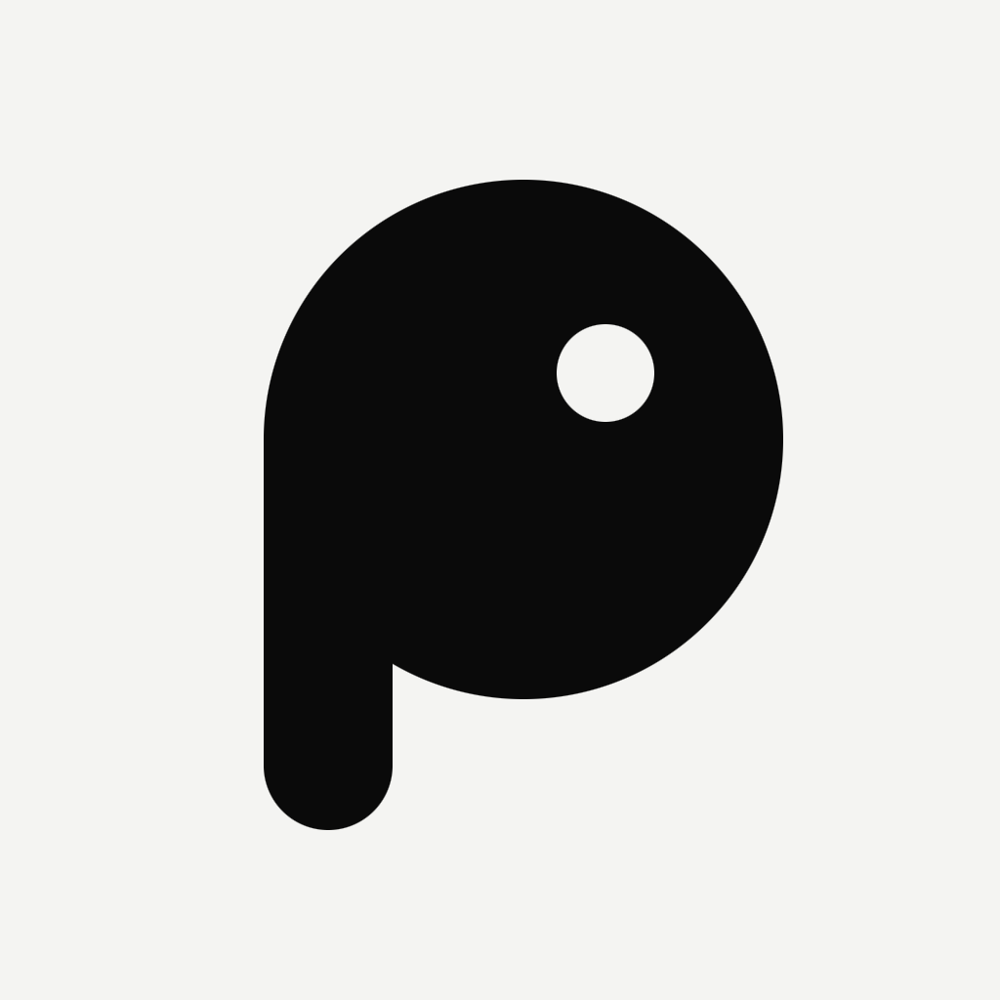

<p align="center">
  <picture>
    <source media="(prefers-color-scheme: dark)" srcset="design/brand/icon-1024.png">
    
  </picture>
</p>

<p align="center">
  <a href="https://www.typescriptlang.org/"></a>
  <a href="https://reactnative.dev/"></a>
  <a href="https://expo.dev/"></a>
  <a href="https://react.dev/"></a>
  <a href="https://vite.dev/"></a>
  <a href="https://nodejs.org/"></a>
  <a href="https://fastify.dev/"></a>
  <a href="https://www.electronjs.org/"></a>
  <a href="https://astro.build/"></a>
  <a href="https://openwrt.org/"></a>
  <a href="https://polkadot.js.org/"></a>
  <a href="https://www.bluetooth.com/"></a>
  <a href="https://www.semtech.com/lora"></a>
  <a href="https://paulmillr.com/noble/"></a>
  <a href="LICENSE"></a>
</p>

# piu.

[English](README.md) · **Português**

Mensageiro **descentralizado e offline-first** da Lunes Network. As mensagens viajam de aparelho em aparelho (Bluetooth LE, Wi-Fi Direct, Wi-Fi Mesh, LoRa, USB/Ethernet), sem internet nem servidor central, com criptografia ponta a ponta e store-and-forward.

**Leia o [Manifesto](MANIFESTO.md)** ([English](MANIFESTO.en.md)): liberdade, segurança e independência na internet.

## Estrutura

Cada pasta em `apps/` é um projeto independente: tem o próprio `package.json`, `package-lock.json`, README e CI (que só roda quando a pasta muda). Instale e rode cada um dentro da sua pasta. A única ligação é o site, que embute o build do painel.

| Pasta | Conteúdo |
|---|---|
| [`apps/provider-panel`](apps/provider-panel) | Painel local do provider (Vite + React + TypeScript), servido pelo `piu-node` em `piu-node.local:8420` |
| [`apps/site`](apps/site) | Site do projeto em PT e EN (Astro), com o painel embutido |
| [`apps/mobile`](apps/mobile) | App Piu para Android e iOS (Expo + React Native), em construção por etapas |
| [`design/brand/`](design/brand) | Identidade do piu.: ícone (claro e escuro), marca, favicons e manifest web |
| [`design/`](design) | Protótipos de referência em HTML (Claude Design): app mobile, painel do provider e site em PT/EN |
| [`docs/design-spec.md`](docs/design-spec.md) | Especificação de design: tokens, tipografia, movimento, telas e regras de produto |
| [`docs/requisitos/`](docs/requisitos) | Documento de requisitos da Lunes Network (IDs FUN, INF e NFR) |
| [`docs/historico-do-design.md`](docs/historico-do-design.md) | Conversa de design com as decisões tomadas |
| [`docs/seguranca/`](docs/seguranca) | Auditoria interna, [pacote para a auditoria independente](docs/seguranca/pacote-auditoria.md) e [guia da chave de release](docs/seguranca/chave-de-release.md) |
| [`docs/economia/`](docs/economia) | [Proposta de modelo econômico](docs/economia/proposta-modelo-economico.md) da carteira LUNES (para decisão) |

## Painel do provider

```bash
cd apps/provider-panel
npm install
npm run dev      # http://localhost:8420
npm run build    # gera dist/
```

Detalhes em [`apps/provider-panel/README.md`](apps/provider-panel/README.md).

## Site

```bash
cd apps/site
npm install
npm run dev      # http://localhost:4321
```

Detalhes em [`apps/site/README.md`](apps/site/README.md).

## App mobile

```bash
cd apps/mobile
npm install
npm start        # Android, iOS ou web
```

Detalhes em [`apps/mobile/README.md`](apps/mobile/README.md).

## Protótipos

Abra qualquer `design/*.dc.html` no navegador (o `support.js` precisa estar na mesma pasta). O índice é `design/Piu.dc.html`. Eles são **referência visual**, não código de produção.

## Roadmap

- [x] Painel do provider para computador, com pareamento ao `piu-node`
- [x] Site do projeto (PT e EN)
- [x] App mobile: todas as telas do design (5 etapas), dados cifrados no aparelho, chaves reais e mensagens reais pelo protocolo
- [x] Protocolo de mensagens (protótipo v0) e auditoria interna de segurança
- [ ] Transporte nativo testado em celulares (Android ↔ Android, iPhone ↔ iPhone, depois Android ↔ iPhone)
- [ ] Grupos, arquivos e canais reais
- [ ] Auditoria de segurança independente ([pacote](docs/seguranca/pacote-auditoria.md))
- [ ] Modelo econômico decidido ([proposta](docs/economia/proposta-modelo-economico.md)), simulação de ataques e liquidação na Lunes Mainnet
- [ ] Chave de release gerada pela Lunes ([guia](docs/seguranca/chave-de-release.md))

## Licença

[GNU Affero General Public License v3.0](LICENSE) (`AGPL-3.0-only`). Quem distribuir o Piu, ou oferecer uma versão modificada a outras pessoas pela rede (por exemplo, o painel do `piu-node`), precisa disponibilizar o código-fonte correspondente sob a mesma licença.
