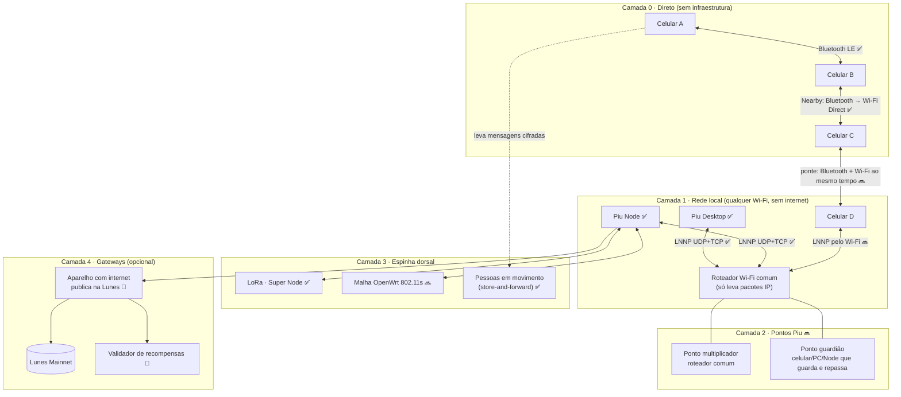
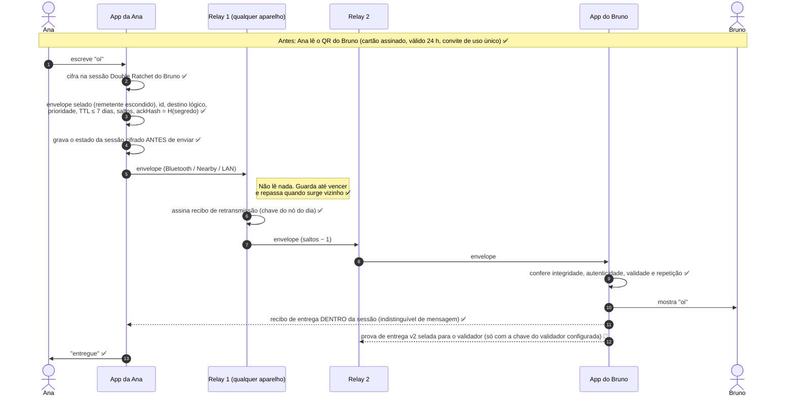
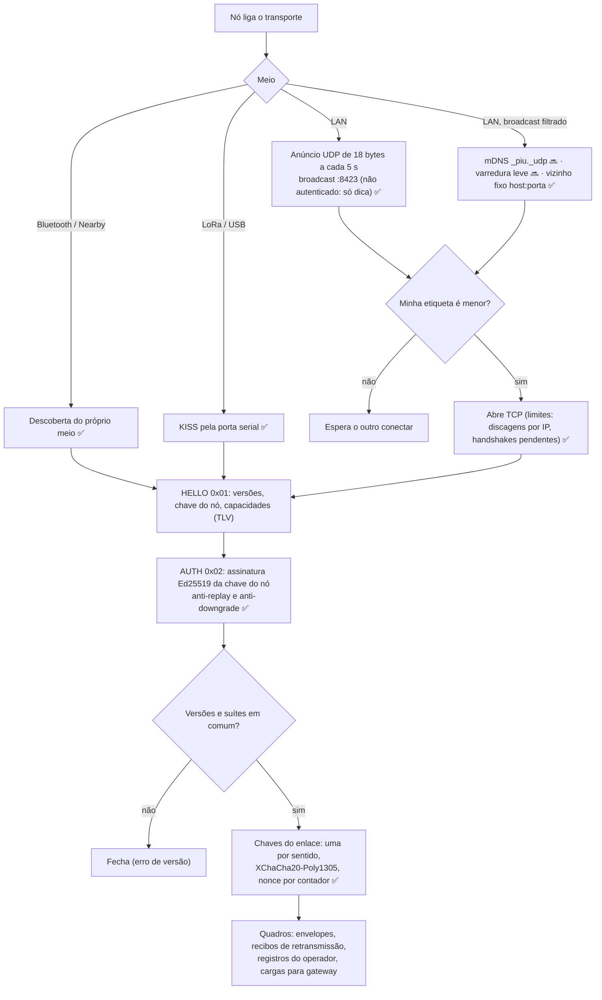
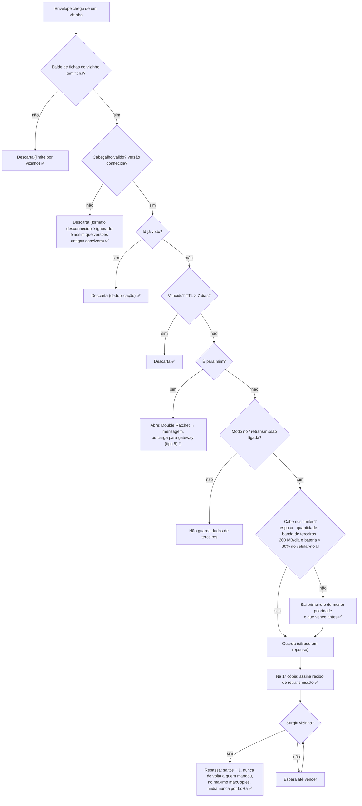
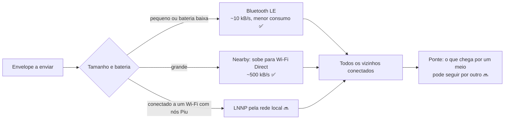
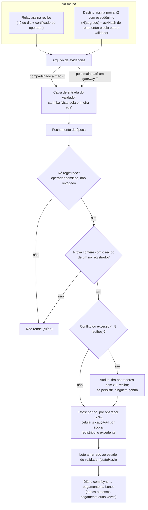
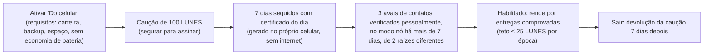
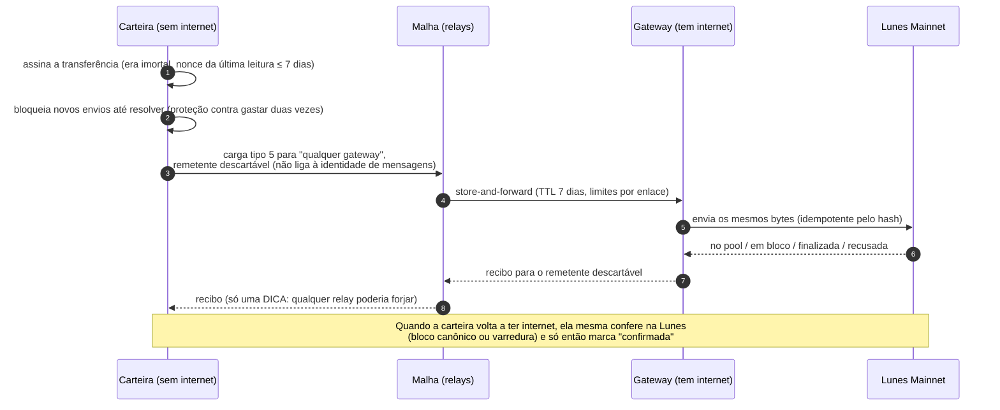
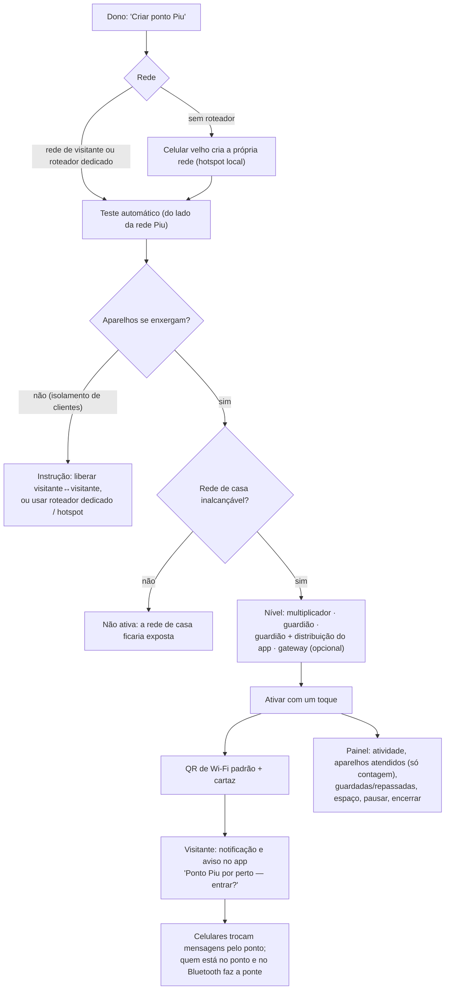

# Fluxograma da rede de comunicação Piu

Como uma mensagem, uma transação e uma recompensa andam pela rede Piu — do celular de quem escreve até quem recebe, sem depender de
internet nem de servidor central. Os diagramas usam [Mermaid](https://mermaid.js.org/) e aparecem desenhados direto no GitHub.

**Legenda de estado** (o que está no código hoje × o que está a caminho):

| Marca | Significado |
|---|---|
| ✅ | Implementado e testado |
| 🧪 | Implementado, ainda sem teste em aparelho real ou desligado por padrão |
| 🔜 | Desenho validado, implementação em andamento ou planejada |

Parte do código descrito aqui (marcas 🧪 e 🔜, e os documentos de economia, carteira e pontos Piu) ainda está em desenvolvimento
e entra no repositório nas próximas versões.

Documentos de referência: [especificação LNNP v1](../lnnp/especificacao-v1.md) ·
[mensagens](../../apps/mobile/src/messaging/README.md) · [prova de entrega v2](../economia/prova-de-entrega-v2.md) ·
[modo nó no celular](../economia/no-celular.md) · [transações pela malha](../carteira/transacoes-pela-malha.md) ·
[pontos Piu com roteadores](pontos-piu-roteadores.md).

---

## 1. Visão geral: quem participa e em que camada



Princípios que valem em todas as camadas:
- **Tudo cifrado de ponta a ponta.** Relays, roteadores e pontos só veem bytes opacos e um cabeçalho mínimo.
- **Identidade técnica ≠ identidade social ≠ carteira.** O nó usa chaves próprias (que giram) e nunca a identidade das conversas.
- **Sem servidor central.** Descoberta local, confiança pelas chaves; a internet é só mais um caminho, nunca obrigatório.

---

## 2. A vida de uma mensagem (ponta a ponta)



Estados que a Ana vê: **criada → aguardando → encaminhada → entregue**.

---

## 3. Enlace entre dois vizinhos (LNNP v1)



---

## 4. O que um relay faz com cada envelope (store-and-forward)



---

## 5. Como o celular escolhe o caminho



---

## 6. Recompensas: da entrega comprovada ao pagamento 🧪

Desligado por padrão: só liga com a chave do validador, o cadastro dos operadores e o endereço da caução definidos.



### 6.1 Celular como nó que rende 🧪



---

## 7. Transação LUNES sem internet (carga pela malha) 🧪



---

## 8. Vínculo celular ↔ Piu Desktop ✅

```mermaid
sequenceDiagram
  participant D as Piu Desktop
  participant P as Celular
  D->>D: QR piu-link:1 (host, chave, segredo, hash do certificado), renova a cada 30 s
  P->>D: lê o QR em Perfil → Conectar ao computador e abre wss com certificado fixado
  D-->>P: handshake; os dois mostram 3 palavras
  Note over D,P: No Desktop: escolher a 3ª palavra entre 4 opções (confirmação real, não só "são iguais")
  P-->>D: espelho cifrado (XChaCha20): conversas, contatos, endereço Lunes
  Note over D: O Desktop nunca assina transação: pagamentos pedidos pelo Desktop são aprovados no celular
```

---

## 9. Ponto Piu com roteador Wi-Fi comum 🔜



O roteador comum **não precisa de firmware novo**: ele só leva pacotes IP entre os aparelhos. Guardar mensagens é papel do
**guardião**; o Piu Node em roteador **OpenWrt** junta as duas coisas e ainda pode formar malha com roteadores vizinhos.

---

*Este documento descreve o estado do código em 06/11/2026. Atualize as marcas ✅ 🧪 🔜 sempre que uma parte mudar de estado.*
