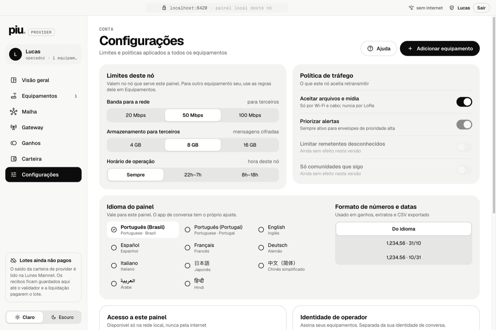
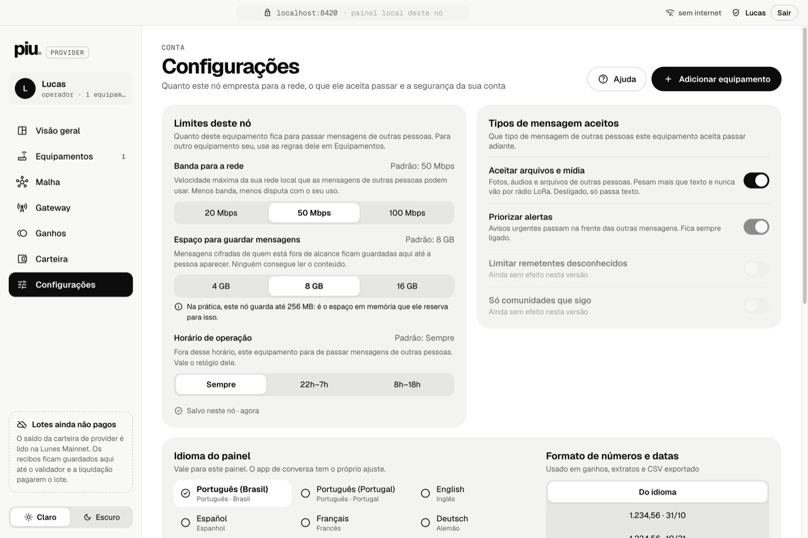
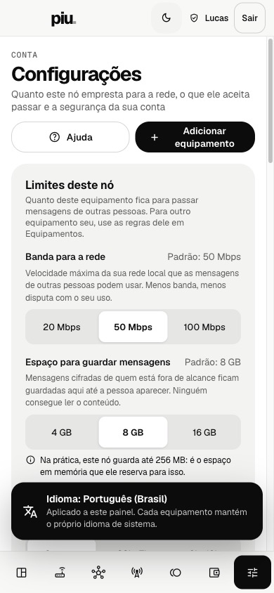

# Piu Provider: funcionamento e configurações didáticas (13/11/2026)

**Ramo:** `fix/provider-config-didatica` (saído da `main` em `a8fa721`), sem push.
**O que foi testado:** o app Piu Provider para computador (Electron, `apps/provider-desktop`), com o `piu-node` embutido e o painel (`apps/provider-panel`), rodando de verdade neste Mac. Cada percurso subiu o app, clicou na tela, leu a API do nó e derrubou tudo no fim (janela da fila, com registro no `coord`). Pasta de dados separada, sem tocar no Piu Provider instalado.
**Antes × depois:** o "antes" é o código da `main` (cópia por `git archive`); o "depois" é este ramo.

**Resultado: APROVADO COM RESSALVAS.** Os fluxos principais funcionam. Corrigi 3 defeitos e reescrevi os textos das Configurações nos 11 idiomas. As ressalvas estão em "O que ficou de fora".

**Atualização de 23/11:** as ressalvas do espaço de mensagens, dos menus em inglês e do "Salvo" ao abrir foram resolvidas. Veja a seção 7. Onde as seções 1 a 5 dizem "4/8/16 GB" ou "256 MB de teto", vale o que está na seção 7.

## 1. Estado de cada fluxo (rodando de verdade)

| Fluxo | Antes | Depois | Evidência |
|---|---|---|---|
| Abrir o app, subir o nó e entrar sozinho (pareamento automático) | ✅ | ✅ | `GET /api/session` → 200; janela em `https://localhost:8420/` |
| Visão geral, Equipamentos, Malha, Gateway, Ganhos, Carteira | ✅ abrem com dados reais (zerados, sem vizinhos) | ✅ | capturas 01 a 06 |
| Mudar banda e espaço nas Configurações | ✅ chega ao motor | ✅ | `relay.limits` passa de 50 Mbps/8 GB para 100 Mbps/16 GB |
| **Espaço para guardar mensagens** | ⚠️ a tela diz "8 GB", mas o nó guarda no máximo **256 MB** | ✅ a tela avisa "Na prática, este nó guarda até 256 MB" | `store.maxBytes = 268435456` com 8 GB **e** com 16 GB |
| Desligar e religar "Aceitar arquivos e mídia" | ✅ | ✅ | motor: `media` true → false → true |
| Exportar backup (pede senha) | ✅ abre | ✅ | captura 09 |
| Fechar diálogos com Esc (código, senha, restaurar) | ❌ o diálogo de backup fica aberto e bloqueia o resto da tela | ✅ os 4 diálogos fecham | no "antes", todos os passos seguintes falharam com "outro elemento intercepta o clique" |
| Trocar a chave, restaurar backup | ✅ abrem (o "antes" só foi testado até o bloqueio do Esc) | ✅ | capturas 10 e 11 |
| Parear celular sem confirmação recente | ✅ pede o código do equipamento | ✅ | `403` da API e o diálogo "Confirme no equipamento" |
| Ajuda da página, troca de idioma, tela de celular (390 px) | — (bloqueado pelo Esc) | ✅ | capturas 13, 14 e 15 |
| Menu Nó → Copiar endereço (só este computador) | ✅ `https://localhost:8420` | ✅ | o endereço responde (401 sem sessão, como deve) |
| **Menu Nó → Copiar endereço (rede local ligada)** | ❌ copia `https://piu-node.local:8420`, que **não abre**: `ENOTFOUND` | ✅ copia `https://imac-de-lucas.local:8420`, que abre | ninguém anuncia `piu-node.local` neste Mac (`dscacheutil` vazio); `imac-de-lucas.local` resolve |

Rede local, depois: ✅ o app copia `https://imac-de-lucas.local:8420`, que responde (`HTTP 401`, pede sessão, como deve). `piu-node.local` continua dando `ENOTFOUND`, e nenhum texto o promete mais.

## 2. O que foi corrigido (com testes antes do código)

1. **Teto real do espaço guardado** (`apps/provider-panel/src/lib/limits.ts`). O nó guarda no máximo o menor entre a escolha, as regras do equipamento e a memória que ele reserva (`PIU_LNNP_MEMORY_MB`, 256 MB por padrão). A tela agora diz o valor real e o motivo. Faz o mesmo com a banda, quando as regras do equipamento pedem menos.
2. **Esc nos diálogos** (`components/Pair.tsx`). Código do equipamento, senha do backup e restaurar backup eram os únicos sem Esc.
3. **Endereço na rede local** (`apps/provider-desktop/src/lan.ts`). O app passa a usar o nome do computador em `.local` (que o macOS e o avahi já anunciam) e os IPs. Nenhum texto, em nenhum idioma, promete `piu-node.local`. O teste antigo que exigia `piu-node.local:8420` foi trocado.
4. **Nome do português.** Em pt-BR e pt-PT, a lista de idiomas mostrava "Portuguese · Brazil".

## 3. Configurações: como estavam e como ficaram

| Onde | Antes | Depois |
|---|---|---|
| Subtítulo da página | "Limites e políticas aplicados a todos os equipamentos" (não é verdade com o nó real: vale só para este) | "Quanto este nó empresta para a rede, o que ele aceita passar e a segurança da sua conta" |
| Limites deste nó | "Valem no nó que serve este painel…" | "Quanto deste equipamento fica para passar mensagens de outras pessoas…" |
| Banda para a rede | dica solta "para terceiros" | "Padrão: 50 Mbps" + "Velocidade máxima da sua rede local que as mensagens de outras pessoas podem usar. Menos banda, menos disputa com o seu uso." |
| Armazenamento para terceiros | dica "mensagens cifradas" | **Espaço para guardar mensagens**, "Padrão: 8 GB", o que é, e o aviso do teto real |
| Horário de operação | dica "hora deste nó" | "Padrão: Sempre" + "Fora desse horário, este equipamento para de passar mensagens de outras pessoas. Vale o relógio dele." |
| Salvar | salvava sozinho, sem nenhum sinal | "Salvo neste nó · agora" depois que o nó confirma |
| Política de tráfego | "O que este nó aceita retransmitir" | **Tipos de mensagem aceitos** |
| Aceitar arquivos e mídia | "Só por Wi-Fi e cabo; nunca por LoRa" | "Fotos, áudios e arquivos de outras pessoas. Pesam mais que texto e nunca vão por rádio LoRa. Desligado, só passa texto." |
| Priorizar alertas | "Sempre ativo para envelopes de prioridade alta" | "Avisos urgentes passam na frente das outras mensagens. Fica sempre ligado." |
| Acesso a este painel | "Disponível só na rede local…" (por padrão, nem na rede: só neste computador) | "Navegadores e aparelhos com este painel aberto. Ele nunca fica aberto para a internet." |
| Identidade de operador | "Assina seus equipamentos. Separada da sua identidade de conversa." | Diz para que serve e por que fazer backup: sem ele, se o equipamento quebrar, perde-se o controle dos outros |
| Rotacionar chaves | "Rotacionar chaves" e "nunca rotacionada" | **Trocar a chave**, "nunca trocada", e o diálogo diz *quando* usar: "se achar que alguém copiou a chave ou o backup" |
| App: Permitir acesso pela rede local | prometia `https://piu-node.local:8420` | mostra o endereço que funciona, por ex. `https://imac-de-lucas.local:8420` |

Todos os textos mudaram nos 11 idiomas (pt-BR, pt-PT, en, es, fr, de, it, ja, zh, ar, hi). O alemão segue o "Sie" e o chinês o "您", como o resto do painel.

## 4. Suítes

| Suíte | Resultado |
|---|---|
| Painel (`vitest`) | 130 de 130 passam (5 arquivos), `tsc -b` sem erro |
| App desktop (`node --test`) | 19 de 19 passam, `tsc --noEmit` sem erro |
| Build do painel e do processo principal | ok |
| `piu-node` (não mexi nele) | 142 de 145. As 3 falhas já existem na `main`: `src/lunes` difere de `apps/mobile/src/lib` (rodar `node scripts/sync-lunes.mjs`) e 2 testes que importam `apps/settlement` sem as dependências instaladas (`@noble/ciphers`) |

Vermelho antes do verde: os testes novos falharam primeiro (painel: 26 falhas; desktop: `lan.test.ts` sem o módulo) e passaram depois do código.

## 5. O que ficou de fora (ressalvas)

- ~~4/8/16 GB continuam como opções~~ Resolvido em 23/11 (seção 7): opções em MB reais e gravação em disco.
- ~~Menus do macOS em inglês~~ Resolvido em 23/11 (seção 7), coberto por testes; falta só conferir olhando no app.
- ~~"Salvo neste nó" aparece ao abrir a página~~ Resolvido em 23/11 (seção 7), conferido no app.
- **"Limitar remetentes desconhecidos" e "Só comunidades que sigo"** seguem desligadas com "Ainda sem efeito nesta versão" (decisão de produto pendente, como já estava).
- Não testei a bandeja do Linux, o Windows nem o pareamento com um celular de verdade.

## 6. Janelas de teste

| Janela | O que rodou | Resultado |
|---|---|---|
| 1 | testes vermelhos + 1ª tentativa do app | vermelho confirmado; o app não abriu (Electron não baixado na instalação; copiei o binário 45.2.1 do checkout principal) |
| 2 e 3 | antes/depois + suítes | achados do teto de 256 MB, do Esc e do `piu-node.local` |
| 4 | suítes + 4 percursos | suítes verdes; a janela de 35 min acabou no último percurso |
| 5 | rede local, depois | endereço novo abre (401); Esc fecha os 4 diálogos também com a rede local ligada |

Nas janelas 4 e 5, o aviso "janela estourada" sai depois do fim do roteiro (o relógio da fila só é encerrado ali); o roteiro já tinha terminado. Em todas: porta 8420 liberada, nenhum Electron sobrando, registro no `coord` removido.

## 7. Segunda rodada (13 a 23/11): espaço real, disco e as pendências

Decisões do dono nesta rodada: "Opções reais + disco" para o espaço de mensagens e, depois, "Pendências do Provider".

### 7.1 O que mudou

| Commit | O que faz |
|---|---|
| `cedc77e` | **Espaço em MB reais.** O roteador guarda no máximo 20 mil mensagens de até 32 KB (~625 MB), então 4/8/16 GB nunca valeriam. As opções viraram 128/256/512 MB (padrão 256 MB, o que já valia). Quem tinha 4, 8 ou 16 GB salvo passa para 256 MB. Memória reservada padrão: 512 MB. **Disco:** cada mensagem num arquivo cifrado próprio (`relay-store/env/`), gravado uma vez, e um `state.bin` pequeno. Antes era um arquivo único regravado inteiro a cada 30 s, que falhava acima de ~380 MB e travava o nó. O arquivo antigo é lido, convertido e só então apagado. |
| `1604e6c` | **Nome dos arquivos.** Era o SHA-256 da mensagem: quem tivesse uma cópia confirmava que o nó a guardava. Agora é um HMAC com chave só do nó. |
| `11fe2b2` | **Pendências.** Menus do app, Editar, Exibir e Janela no idioma do app (11 idiomas). "Salvo neste nó" só quando o dono muda algo. Nas regras dos Equipamentos e no assistente, um aviso diz que um nó guarda hoje até 512 MB (as opções 1/4/8 GB continuam, porque viajam assinadas pela malha e existem no celular). |
| `7532546` | **Aviso com dado velho.** Logo depois de trocar o espaço ou a banda, a tela mostrava por alguns segundos um aviso errado ("Na prática, até 256 MB" com o motor em 512 MB). Achado na rodada com o app. |
| `01aec9e` | **Lista de Equipamentos.** "0 de 0,5 GB" virou "0 de 512 MB" (256 MB apareceria como "0,3 GB"). |

Todos com teste antes do código (vermelho visto antes do verde).

### 7.2 Suítes (pela fila, em 23/11, sobre o commit `11fe2b2`)

| Suíte | Resultado |
|---|---|
| Painel (`vitest`) | 155 de 155; `tsc -b` sem erro |
| App desktop (`node --test`) | 22 de 22; `tsc --noEmit` sem erro |
| `piu-node` | 149 de 152; `tsc` sem erro. As 3 falhas são as mesmas da `main` (cópia de `src/lunes` e 2 testes que dependem de `apps/settlement`) |
| Builds do painel e do app | ok |

Depois dos commits `7532546` e `01aec9e` rodei só o painel, direto (leve): 179 de 179, `tsc -b` sem erro. **A suíte completa e o build não rodaram de novo sobre esses dois commits.**

### 7.3 App de verdade, três etapas (pela fila, 23/11, build do `11fe2b2`)

Saída completa em [tres-etapas-2026-11-23.txt](2026-11-13-provider/tres-etapas-2026-11-23.txt).

| Etapa | Resultado |
|---|---|
| 1. App antigo (`main`): um segundo nó Piu conecta e manda uma mensagem real | ✅ guardou 1 mensagem (593 bytes); ao fechar gravou `relay-store.bin` (1081 bytes) |
| 2. App novo, mesma pasta | ✅ "1 mensagens guardadas… restauradas"; ao fechar: `relay-store/env/<nome>.bin` (629 bytes, 600), `state.bin` (353 bytes, 600), pastas 700; o arquivo antigo sumiu |
| 2. Opções de espaço | ✅ 128 MB → 134217728; 512 MB → 536870912; 256 MB → 268435456 bytes no motor |
| 2. "Salvo neste nó" | ✅ 0 vezes ao abrir sem mexer; aparece depois de uma mudança |
| 3. App novo de novo | ✅ a mensagem voltou da pasta nova (`restored.envelopes = 1`) |

### 7.4 O que NÃO foi validado

- **Os commits `7532546` e `01aec9e` no app de verdade.** A rodada que confirmaria que o aviso errado sumiu estava na fila e foi cancelada no encerramento de 23/11. Estão cobertos só por testes do painel.
- **Menus do macOS no app.** Cobertos por testes (todo item com texto, nos 11 idiomas); ninguém olhou o menu aberto. O roteiro de automação não lê o menu.
- **Regras dos Equipamentos e assistente.** O aviso novo tem teste do texto, mas não foi visto na tela (a captura pegou só a lista).
- **Automação.** O `_electron.launch` do Playwright parou de completar nesta máquina (o app abre normal; causa não encontrada). O roteiro passou a abrir o app direto e a conectar pela porta de depuração.
- Linux, Windows e pareamento com celular de verdade continuam sem teste.

### 7.5 Segurança do que fica no disco

AES-256-GCM em cada arquivo, chave derivada da semente do nó, cada mensagem amarrada ao nome do arquivo, permissões 600/700, gravação atômica. Limites que já existiam: a semente (`node.seed`) fica na mesma pasta de dados, então quem copiar a pasta inteira abre os cabeçalhos (nunca o conteúdo, que é cifrado de ponta a ponta); apagar não sobrescreve o disco; o tamanho de cada arquivo mostra o tamanho aproximado de cada mensagem.

### 7.6 Fica para depois

- Guardar mais que ~625 MB exige subir os limites do roteador (protocolo, vale também no celular) e ler as mensagens do disco em vez de mantê-las na memória.
- Trocar as regras dos Equipamentos (1/4/8 GB) por valores reais mexe no formato assinado da malha e no app do celular.
- Semente do nó no Chaveiro do sistema.

